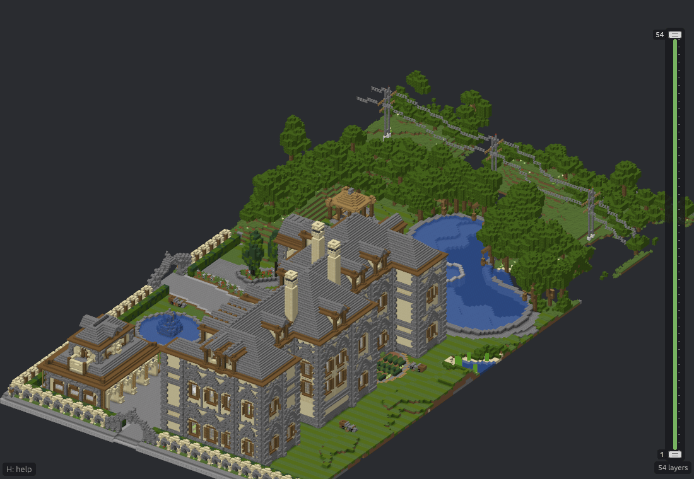
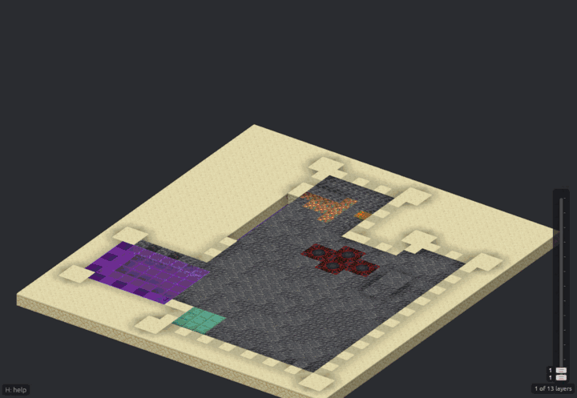
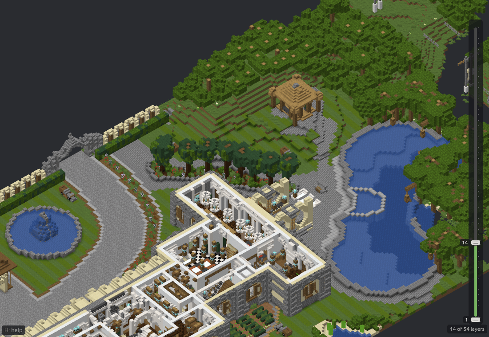
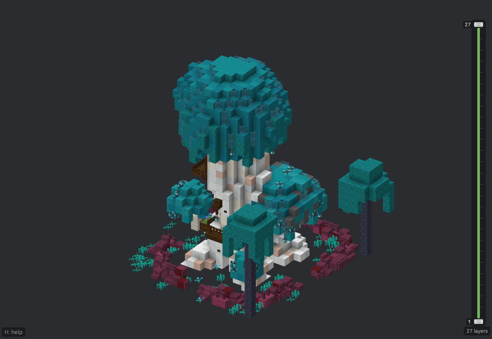
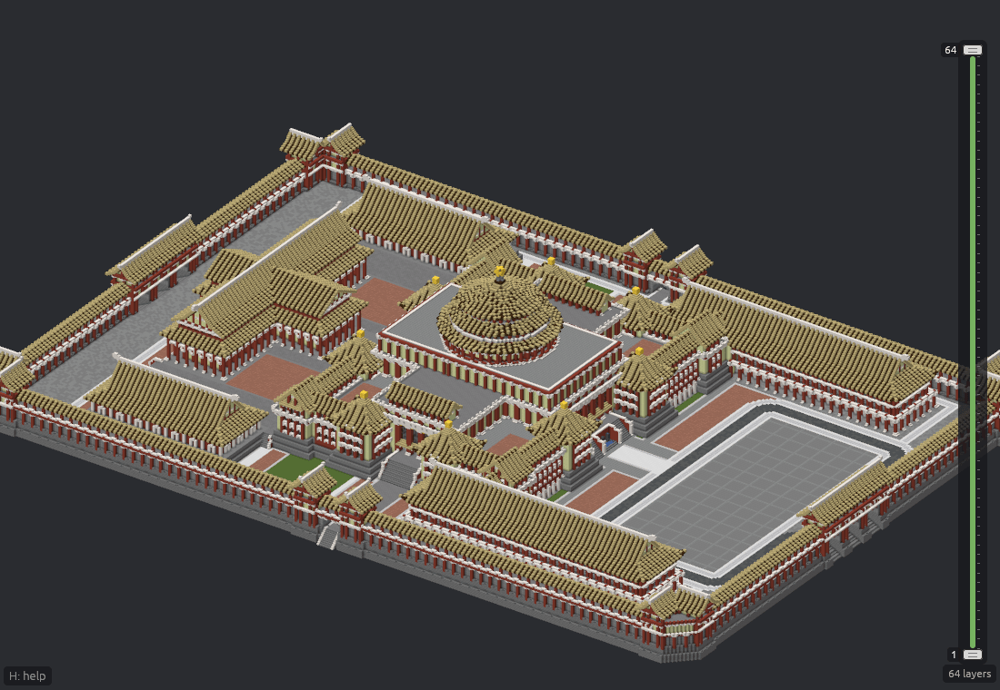
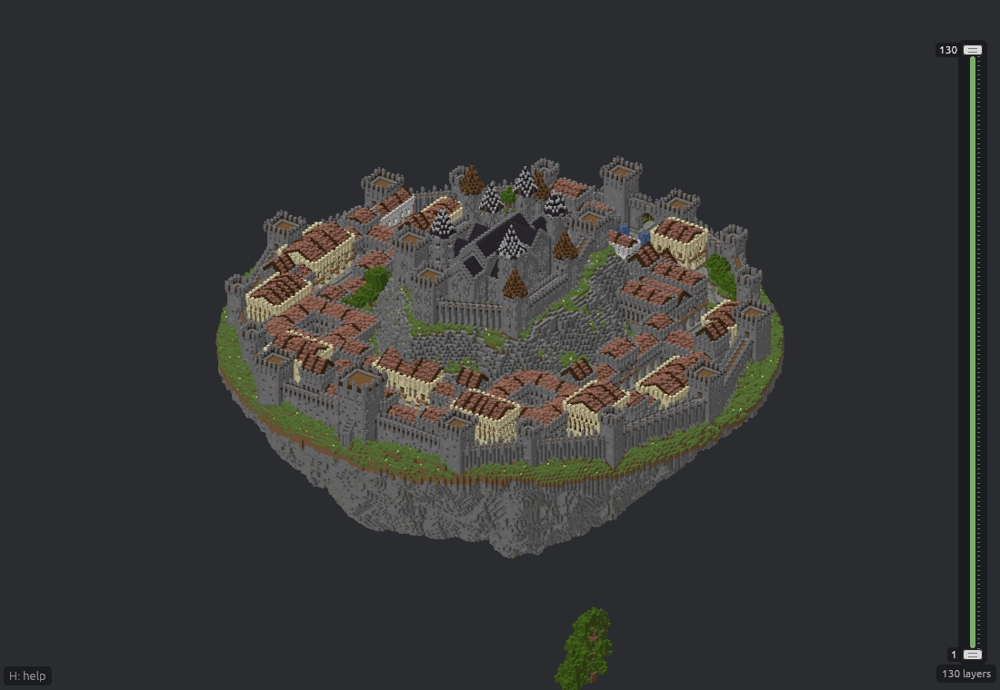

# schemview

A small desktop viewer for Minecraft schematics. Double-click a `.litematic`,
`.schematic` or `.schem` file and it opens in 3D with the real block textures.
You can orbit, zoom, and peel the build apart layer by layer.

I wanted to look at a schematic without starting Minecraft, loading a world
and pasting it in with Litematica. So this does one thing: open the file and
show it. It's written in Rust with OpenGL and ships as a single 9 MB binary.

## Layer bar

The bar on the right works like the layer slider in a 3D printing slicer. The
top handle sets the highest layer shown, the bottom handle the lowest. Pull the
top one down and you're looking at the inside of the build: rooms, redstone,
the wiring under the floor.

- Drag a handle, or click the track to move the nearest handle there.
- Drag the green part between the handles to move both. Squeeze them down to
  one layer and drag that to step through the build one slice at a time.
- Scroll over the bar to step the nearest handle.
- Page Up / Page Down move the top handle, Shift + Page Up / Page Down the
  bottom one. Double-click the bar to show everything again.

The cut faces are solid, so you see the floor of each room and not a hollow
shell. Hiding layers happens on the GPU and is instant, even on large builds.

## Rendering

schemview reads blockstates, block models and textures from the Minecraft
client jar on your computer when it opens a file. Nothing from Minecraft is
included in this repository or in the downloads. It picks the newest release
it finds (1.13 or later) in these places:

- `~/.minecraft/versions` (Linux), and the Flatpak launcher's copy of it
- `%APPDATA%\.minecraft\versions` (Windows)
- `~/Library/Application Support/minecraft/versions` (macOS)
- Prism Launcher's `libraries` folder on all three

Set `SCHEMVIEW_JAR=/path/to/client.jar` to use a specific jar. Without any jar
it falls back to flat colours per block.

Blocks get their in-game shapes: stairs, slabs, fences, panes, walls, doors,
pistons, redstone, plants and so on. Grass, leaves and water get Minecraft's
default tints, and redstone dust gets brighter with its power level.
Transparency follows the game's render types. Glass and leaves have see-through
gaps; stained glass, slime, honey, ice and water are blended and sorted back to
front. Old MCEdit files with numeric block IDs are converted to modern blocks
first, so they get textures too.

| | |
|---|---|
|  |  |
|  | |

## Formats

The file type is detected from the content, not the extension.

- Litematica `.litematic`, including multi-region files
- Sponge / WorldEdit `.schem`, versions 1 to 3
- MCEdit / Schematica `.schematic`, with legacy numeric IDs
- Vanilla structure block `.nbt`

## Controls

| Input | Does |
|---|---|
| Left drag | orbit |
| Scroll, pinch, `+` / `-` | zoom towards the cursor |
| Right or middle drag, Shift + left drag | pan |
| Arrow keys | orbit |
| `R`, `Home`, double-click | reset the view |
| `I` | show or hide the file info |
| `H` | help |
| `Q`, `Esc` | quit |

Drop another file on the window to open it. The camera is orthographic, and
there is no free flying around. That's on purpose.

## Install

### Linux

Download `schemview-…-linux-x86_64.tar.gz` from the
[releases page](https://github.com/immineal/schemview/releases), unpack it and run:

    ./install.sh

That copies the binary to `~/.local/bin`, registers the file types and makes
schemview the default app for `.litematic`, `.schematic` and `.schem`. After
that, double-clicking one of those files opens it. `./install.sh --uninstall`
removes everything again.

### Windows and macOS

The releases also have builds for Windows (x86_64) and macOS (Apple Silicon and
Intel). I only use Linux, so these are built by GitHub Actions and are
untested. On Windows, right-click a schematic, pick "Open with" and choose
`schemview.exe`. On macOS the binary isn't signed. Run
`xattr -d com.apple.quarantine schemview` once before starting it.

### From source

You need a recent stable Rust toolchain.

    git clone https://github.com/immineal/schemview
    cd schemview
    ./install.sh          # Linux: builds and installs
    cargo build --release # anywhere else

## Speed

Measured on a 12-thread desktop with an RTX 3070:

- A 117 × 54 × 224 mansion (167k blocks): parsed, textured and meshed in about 160 ms.
- Gaia's Vault, 547 × 153 × 681 with 6 million blocks and 8 million triangles:
  about 1.2 s, then a steady 60 fps while orbiting.

Meshing runs on all cores. Sorting see-through faces for big builds happens on
a background thread, so turning the view doesn't stutter.

## Command line

    schemview FILE              open a file
    schemview --stats FILE...   load and mesh without a window, print sizes and timings

Environment variables, mostly for testing and screenshots:

| Variable | Effect |
|---|---|
| `SCHEMVIEW_JAR=path` | use this Minecraft client jar |
| `SCHEMVIEW_FLAT=1` | flat colours instead of textures |
| `SCHEMVIEW_INFO=0` | start with the file info hidden |
| `SCHEMVIEW_LAYERS=lo,hi` | start showing only layers lo to hi (counted from 1) |
| `SCHEMVIEW_VIEW=yaw,pitch` | start at this angle, in degrees |
| `SCHEMVIEW_ZOOM=f` | start zoomed in by factor f |
| `SCHEMVIEW_MAXIMIZED=1` | open maximized |
| `SCHEMVIEW_DEBUG=1` | print GL info and timings |
| `SCHEMVIEW_SELFTEST=1` | drive the camera and layer bar with fake input, then quit |

## Limits

- Block entities that Minecraft draws with special renderers have no block
  model to copy. Chests, signs, beds and shulker boxes show as simple boxes
  with their texture. Banners, mob heads and conduits are plain coloured shapes.
- Entities (item frames, armor stands, mobs) aren't shown.
- Animated textures show their first frame. Tints use Minecraft's default
  colours, not the biome's.

## Credits

The screenshots show builds from my schematics folder. The mansion schematic is
by Der_Hippogreif and the Bluebell Mushroom by Pink_Slime. I don't know who
built the temple and the floating castle. `examples/blocks.schem` is a test
file with one of each tricky block type, generated by `examples/make_blocks.py`.

## License

MIT, see [LICENSE](LICENSE).

Not an official Minecraft product. Not approved by or associated with Mojang
or Microsoft.
